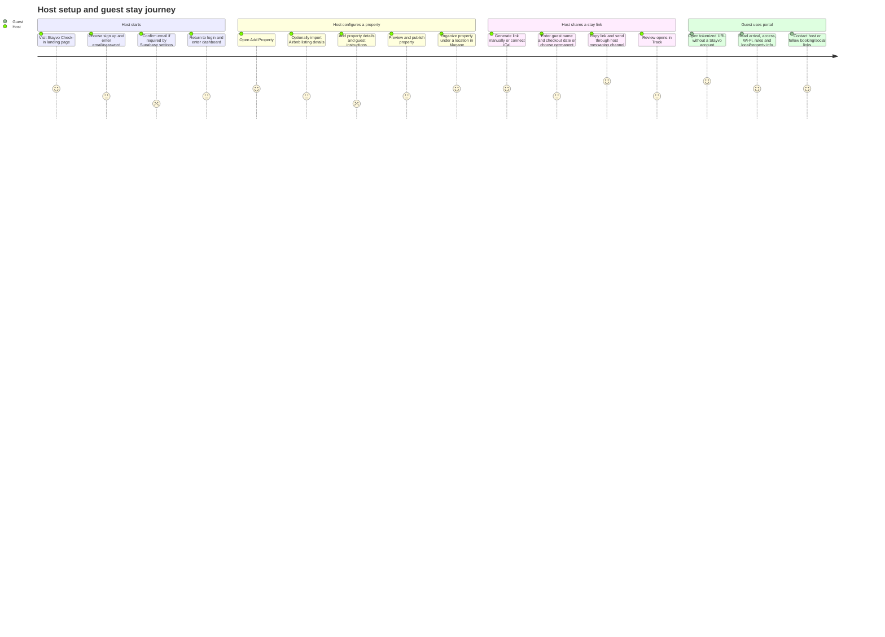

# Stayvo Check-in — Project Knowledge and Product Walkthrough

**Purpose:** A source-grounded map of the current application for planning usability, onboarding, design, functionality, and adoption improvements.

**Scope and confidence:** This report describes the repository checked out on branch `refactor/stayvo-check-in` at `da55f1d`, plus the uncommitted working-tree changes present during inspection. It is based on source code, migrations, configuration, and repository documentation; it does not connect to Supabase, Stripe, or Vercel to verify live production state. “Confirmed” means visible in the checked-out source. “Opportunity” means a product recommendation, not an implemented feature or confirmed user need.

## 1. Current project status

- Branch: `refactor/stayvo-check-in`.
- HEAD: `da55f1d`.
- Branch tracking: `origin/refactor/stayvo-check-in`, local branch is ahead by one commit at inspection.
- Working tree: has uncommitted changes spanning the authentication callback redirect helper/tests, service worker privacy/test, Tailwind content scanning, and host UI/property/Track presentation. Those changes are pre-existing and intentionally preserved; this document does not describe them as committed behavior.
- No source, configuration, migration, or database changes were made for this report. The new file is documentation only.
- The repository contains migration `0024_remove_legacy_host_plan.sql`. Repository history/docs say it is prepared and not applied. This inspection did not query the live database, so live migration state is not independently verified here.

## 2. Product overview

Stayvo Check-in is the free host-facing property editor and guest information portal in the Stayvo product family. Hosts authenticate with Supabase Auth. Stayvo Core is a separate application that uses Firebase Auth and a separate database; a future provisioning/identity-mapping connection is described in docs but is not implemented here.

The application has two distinct experiences:

1. **Host/admin experience:** create and organize properties, publish or draft them, generate guest links, import calendar bookings, manage media, and inspect link opens.
2. **Guest experience:** a public, token-addressed portal with property and stay-specific information. Guests do not need a Stayvo host account.

The key product loop is: host creates a property → adds guest information → creates a dated or permanent link (or imports bookings through iCal) → sends the URL to the guest → guest opens the portal → host can see approximate open/device activity.

## 3. Architecture diagram

```mermaid
flowchart LR
  Host[Host browser / PWA] --> Next[Next.js App Router]
  Next --> Proxy[proxy.ts and Supabase session refresh]
  Proxy --> Auth[Supabase Auth / auth.users]
  Next --> Actions[Server actions and route handlers]
  Actions --> DB[(Supabase Postgres + RLS)]
  Actions --> Storage[Supabase Storage fallback]
  Actions --> R2[Cloudflare R2 when configured]
  Guest[Guest browser] --> Portal[Public token route]
  Portal --> RPC[get_guest_portal_by_token RPC]
  RPC --> DB
  Guest --> OpenRPC[record_guest_link_open RPC]
  OpenRPC --> DB
  Cron[Vercel daily cron] --> IcalAPI[/api/cron/sync-ical]
  IcalAPI --> Ical[Encrypted iCal feeds and sync service]
  Ical --> External[Airbnb / booking calendar providers]
  Ical --> DB
  Core[Separate Stayvo Core / Firebase Auth] -. future provisioning only .-> Mapping[Not implemented]
```

### Runtime boundaries

- **Next.js App Router:** server-rendered pages fetch data with the Supabase server client; client components handle interactive editors, navigation, forms, filtering, DnD, clipboard, and media flows.
- **`proxy.ts`:** performs app/marketing hostname redirects and delegates session refresh and protected-route enforcement to `lib/supabase/middleware.ts`.
- **Supabase:** identity, Postgres, RLS, RPCs, and (where used) Storage. The public guest route uses narrowly scoped database RPCs instead of exposing host tables to anonymous clients.
- **Media storage:** R2 is selected when the complete R2 configuration is present; otherwise the application has a Supabase Storage path. Public guest media URLs are rendered by the guest portal.
- **iCal:** authenticated server actions manage feeds; a daily Vercel cron invokes a server route; a sync service fetches/parses feeds and reconciles guest links.
- **Stayvo Core:** separate system, not a runtime dependency of Check-in.

## 4. Directory and module map

| Area | Contents and responsibility |
|---|---|
| `app/` | Next.js routes, layouts, server pages, client screens, server actions, and API routes. |
| `app/dashboard/` | Dashboard, Manage, Track, Profile, shared host shell/navigation, loading/error states. |
| `app/properties/` | New/edit/preview routes and property editor; `property-editor/` holds modules, navigation, shell, and form types. |
| `app/_guest/` | Shared public guest portal page/view, cookie notice, legal footer, section components. |
| `app/stay/[token]/` | Legacy/default public token route plus open tracking, quick navigation, and guest copy interactions. |
| `app/[hostSlug]/[token]/` | Host-branded slug route that renders the same guest portal. |
| `app/actions/` | Authenticated server actions for properties, locations, guest links, media, iCal, account settings, and open statistics. |
| `app/api/` | iCal cron endpoint and signed guest-media upload presign/completion endpoints. |
| `components/ui/` | Local shadcn/Radix-style Button, Card, Dialog, Input, Label, and Textarea primitives. |
| `lib/` | Shared business helpers, validators, domain utilities, Supabase clients, media, iCal, Airbnb parsing, fonts, and styling recipes. |
| `lib/supabase/` | Browser/server/admin clients, environment access, middleware, safe auth, and error handling. |
| `lib/ical/` | iCal source types, parser, source labels, and synchronization logic. |
| `supabase/migrations/` | Ordered database history, `0001` through `0024`. The last migration is a prepared host-plan removal, not proof it has been applied. |
| `public/` | Brand assets, icons, manifest-linked assets, and service worker. |
| `docs/` | Identity/billing wind-down, design parity specification, legal checklist, Airbnb import QA, and this project knowledge document. |
| `scripts/` | Local dev/start helpers, postinstall handling, and brand asset check. |

## 5. Routes and feature inventory

| Route/feature | Purpose and actual behavior | Main source files | Data dependencies and limitations |
|---|---|---|---|
| `/` | Public marketing/landing page: product introduction, feature explanation, FAQ, and sign-up/login entry points. Hostnames are handled by `proxy.ts` and `lib/site-hosts.ts`. | `app/page.tsx`, `proxy.ts`, `lib/site-hosts.ts` | Marketing claims are hard-coded copy. Test conversion and clarity with real first-time hosts; source alone cannot establish conversion outcomes. |
| `/signup` | Sends users into the sign-up mode on `/login`. | `app/signup/page.tsx`, `app/login/LoginPageClient.tsx` | Signup is implemented in the login client rather than as a separate form route. |
| `/login` | Email/password sign-in, account creation mode, legal acknowledgement, and forgot-password entry. | `app/login/*`, `lib/supabase/client.ts` | Uses Supabase Auth. The signup experience depends on Supabase email-confirmation settings. |
| `/login/forgot-password` and `/login/reset-password` | Request reset email, process confirmation callback, and set a new password. | `app/login/forgot-password/*`, `app/login/reset-password/*`, `app/auth/confirm/route.ts` | Email delivery and confirmation behavior depend on Supabase project configuration and templates. |
| `/dashboard` | Live-property overview grouped by location, guest-link generation/management, calendar sync entry points, and no-property/empty-location states. | `app/dashboard/page.tsx`, `DashboardClient.tsx`, `PropertyCard.tsx`, `DashboardLocationFilterSheet.tsx` | Server reads locations, live properties, guest links, feeds, and counts. Location filter preference is client localStorage scoped by user ID. Only live properties appear as active dashboard cards. |
| `/dashboard/manage` | Organize all properties and locations, create/edit/clone/delete properties, reorder, move, and change live/draft status. | `app/dashboard/manage/page.tsx`, `ManageDashboardClient.tsx`, `ManageDashboardClientNoSSR.tsx`, `app/actions/locations.ts`, `app/actions/properties.ts` | Server loads host-owned records. DnD uses `@dnd-kit`. Mobile and desktop layouts differ. |
| `/dashboard/track` | Guest-link tracking view grouped by location/property, with checkout/permanent status, approximate opens/devices, and last-open time. | `app/dashboard/track/page.tsx`, `TrackGuestLinksClient.tsx`, `app/actions/guest-link-open-stats.ts` | Depends on guest links and `get_guest_link_open_stats` RPC. “Device” means a browser-profile UUID, not a verified person/device. |
| `/dashboard/profile` | Host display name/public URL slug, profile/account preferences, email/password changes, theme, logout, and account deletion. | `app/dashboard/profile/page.tsx`, `ProfileClient.tsx`, `app/actions/host-account.ts` | Uses Supabase user metadata and Auth. Service-role key is required for account deletion. No current subscription management UI. |
| `/properties/new` | Initializes/chooses a location and opens the editor in create mode. | `app/properties/new/page.tsx`, `PropertyFormClient.tsx`, `PropertyForm.tsx` | Defaults new property to live; a General location can be created automatically. |
| `/properties/[propertyId]/edit` | Loads one owned property and child content, then opens the modular editor. | `app/properties/[propertyId]/edit/page.tsx`, `PropertyFormClient.tsx`, `PropertyForm.tsx`, `property-editor/*` | Requires owner auth. Several content tables are fetched independently. |
| `/properties/[propertyId]/preview` | Host preview of the guest-facing property content. | `app/properties/[propertyId]/preview/page.tsx`, `PreviewClient.tsx` | Authenticated/owner-scoped preview; useful for checking content before sharing. |
| `/stay/[token]` | Public guest portal route using the default Stayvo path. | `app/stay/[token]/page.tsx`, `app/_guest/GuestPortalPage.tsx`, `GuestPortalView.tsx` | Token and expiry/permanent status determine access. No host login. |
| `/{hostSlug}/{token}` | Host-slug version of the same public portal. | `app/[hostSlug]/[token]/page.tsx`, `app/[hostSlug]/layout.tsx`, `lib/guest-portal-url.ts` | Slug derives from host display-name metadata; reserved path names are handled by helper logic. |
| `/api/cron/sync-ical` | Authenticated cron endpoint for all enabled iCal feeds. | `app/api/cron/sync-ical/route.ts`, `lib/ical/sync-feed.ts`, `vercel.json` | Requires `CRON_SECRET` and service-role Supabase access. Vercel schedule is daily at `0 6 * * *`. |
| `/api/guest-media/presign`, `/api/guest-media/complete` | Issue signed R2 upload details and register completed media. | `app/api/guest-media/*`, `lib/guest-media-upload-api.ts`, `app/actions/guest-property-media.ts` | R2-only direct-upload path when configured; validates host/property/path and records media metadata. |
| `/terms`, `/privacy` | Legal/product disclosures. | `app/terms/page.tsx`, `app/privacy/page.tsx` | Legal copy includes historical subscription context; use `docs/legal-pages-checklist.md` when product/data behavior changes. |

### Feature inventory at a glance

- Host account creation, sign-in, email confirmation, password reset, email/password updates, logout, deletion.
- Free Check-in access for authenticated Supabase users; no current Stripe application code is present.
- Multi-property host account with location grouping, live/draft state, ordering, clone, rename, delete, and movement between locations.
- Property CMS for details, location, hero image, check-in steps, house rules, FAQ, custom blocks, host contact, social/direct-booking links, display ordering, iCal, and danger-zone actions.
- Airbnb listing URL import as a best-effort property prefill.
- Guest link creation with generated/custom token, guest name, checkout date, expiry, or permanent setting; links can be copied, edited, extended, and deleted.
- Multiple iCal feeds per property, manual sync, daily cron sync, booking/link reconciliation, and sync status/error summaries.
- Guest portal with property information, stay name/date, directions, parking, check-in instructions/media, Wi-Fi, house rules, FAQs, guidebook tips from legacy data, custom sections, host contact, and social/direct-booking links.
- Approximate guest portal open/device analytics.
- Reusable host media library, image compression/hash deduplication, R2/Supabase storage paths, video/media embeds.
- Responsive host shell and PWA/service-worker support.

## 6. Authentication, account model, and data flow

### Host identity

- **Confirmed:** Supabase Auth is the Check-in identity source (`auth.users`). Email/password, confirmation, and password-reset flows are implemented in `app/login/`, `app/auth/confirm/route.ts`, and `lib/supabase/*`.
- There is no dedicated Check-in `profiles` table in the documented/current schema. `host_display_name` is stored in Supabase Auth user metadata and used for the branded guest-link URL slug; fallback display name is email prefix/“Host”.
- `lib/check-in-access.ts` models current Check-in access as presence of an authenticated user ID. The Check-in/Core identity mapping in `docs/stayvo-identity.md` is future architecture only.
- `proxy.ts` refreshes the session on matched routes and `lib/supabase/middleware.ts` redirects unauthenticated `/dashboard*` and `/properties*` requests to `/login` with a return path. Individual server pages/actions also authenticate and enforce ownership.

### Host data ownership

The core ownership chain is:

```text
auth.users.id
  ├── properties.user_id
  │     ├── property_check_in_steps.property_id
  │     ├── property_house_rules.property_id
  │     ├── property_guidebook_tips.property_id
  │     ├── property_faqs.property_id
  │     ├── property_custom_details.property_id
  │     ├── guest_links.property_id
  │     │     └── guest_link_visitors.guest_link_id
  │     └── property_ical_feeds.property_id
  ├── locations.user_id ← properties.location_id
  └── host_media_assets.user_id
```

Child rows generally cascade with property deletion. `properties.location_id` references `locations` with `ON DELETE RESTRICT`, so a location cannot simply be deleted while properties still refer to it; the UI/action must account for reassignment or deletion. Host tables have RLS policies that use `auth.uid()` directly or verify ownership through the parent property. Public guest reads are routed through the security-definer `get_guest_portal_by_token(text)` RPC rather than broad anonymous select on all host tables.

### Property save flow and data integrity

- `app/properties/[propertyId]/edit/page.tsx` selects the property and related ordered rows, then passes initial values to the client editor.
- `app/actions/properties.ts` validates the authenticated user/ownership and normalizes input. New properties insert the parent and then related child rows. Editing updates the property and replaces ordered child rows (delete then insert); media cleanup runs after content changes.
- **Confirmed reliability limitation:** related child replacement is multiple independent PostgREST statements, not one database transaction. An intermediate failure can leave a partial set of child records. The clone flow similarly inserts the new property and child records in stages, with compensating deletion on several failure paths.
- **Confirmed Guidebook Tips gap/data-loss behavior:** the database and public portal still support `property_guidebook_tips`, and the server action still accepts/saves them. However, the current modular editor does not expose a Guidebook Tips module, and `PropertyForm.getCurrentFormInput()` supplies `guidebookTips: []`. An edit save deletes existing guidebook tip rows and reinserts none. Treat restoration/preservation of legacy tips as an early correctness item before relying on that content.

## 7. User journey map



### Journey notes: confirmed behavior and likely friction

1. **Discover → sign up:** landing page sends the visitor to `/login?mode=signup`; `/signup` is a redirect alias. Signup is an email/password form with legal acknowledgement. Confirmation requirements and email latency are Supabase-project dependent.
2. **First dashboard visit:** if no properties exist, Dashboard and Manage provide an add-property path. The editor can be opened directly from the create action. Property creation currently defaults to live, which may surprise someone who has not completed all guest-facing content.
3. **Property setup:** the editor uses module navigation: Hero, Details (including Airbnb import), Check-in, Rules, FAQ, Custom, Host, Social, iCal, Section order, and Danger zone. The user can preview. The editor retains a relatively comprehensive CMS; first-time setup has many decisions and no source-confirmed guided completion checklist.
4. **Publish and manage:** Manage is the place for location organization, live/draft toggles, reorder, clone, edit, and delete. Dashboard is optimized around active/live properties and guest-link actions; Track is analytics-oriented.
5. **Share:** manual generation requires a property and either checkout date or permanent status; guest name is optional. Generated expiry is checkout date + two days at 23:59:59 UTC. Custom path accepts lowercase letters/numbers/hyphens, length 4–24. Existing tokens can be kept while changing metadata or edited to another unique custom token.
6. **Guest arrival:** a token URL yields the portal from the database RPC. Expired links are rejected by the portal; permanent links have no expiry. Guests are not asked to create accounts. The portal captures one approximate visitor identity per browser storage profile and sends open events.

## 8. Feature walkthroughs

### 8.1 Dashboard

- **Purpose:** quickly see live properties and create/share stay links.
- **Behavior:** the server fetches owner locations, live properties, link records, feed summaries, and overall property count. Client groups by location, filters visible locations, displays property cards, link lists, sync actions, and onboarding/empty states. Location selection persists under a versioned key scoped by Supabase user ID.
- **Files:** `app/dashboard/page.tsx`; `DashboardClient.tsx`; `PropertyCard.tsx`; `DashboardLocationFilterSheet.tsx`; `_components/NoPropertiesEmptyState.tsx`; `app/actions/guest-links.ts`; `app/actions/ical-feeds.ts`.
- **Limitations/opportunities:** live-only presentation can make draft properties seem absent unless users know to use Manage. Improve first-run explanation and link status labels; consider a clearer “draft vs live” mental model. Server data is dynamically fetched rather than cached, prioritizing freshness over reducing repeated reads.

### 8.2 Manage

- **Purpose:** operational organization and lifecycle management for all properties, including drafts.
- **Behavior:** location sidebar/sections, property rows, add/edit/rename/delete locations, property create/edit/clone/delete, live/draft switch, ordering, and movement. DnD uses dnd-kit sensors and ordered IDs are persisted by server actions.
- **Files:** `app/dashboard/manage/page.tsx`; `ManageDashboardClient.tsx`; `ManageDashboardClientNoSSR.tsx`; `app/actions/locations.ts`; `app/actions/properties.ts`.
- **Limitations/opportunities:** a user must understand why Dashboard and Manage show different sets (live vs all). Add lightweight explanatory copy or onboarding cues. Guard destructive actions with clear preview and impact summary; current property delete warns that guest links/data are removed.

### 8.3 Track

- **Purpose:** show which guest portals have been opened and when.
- **Behavior:** server loads live properties, locations, guest links and aggregated visitor stats; guest link sorting uses checkout relevance. UI groups by location/property and presents Opened/open counts, approximate browser/device count, date/permanent state, and last-open time.
- **Files:** `app/dashboard/track/page.tsx`; `TrackGuestLinksClient.tsx`; `app/actions/guest-link-open-stats.ts`; `app/stay/[token]/StayOpenTracker.tsx`; migration `0013_guest_link_visitor_tracking.sql`.
- **Limitations:** tracking counts browser-profile UUIDs, not verified unique humans or physical devices. Browser privacy settings, localStorage clearing, shared devices, bots, or repeat visits affect counts. This should be described as approximate “browser/device activity”, not precise guest attendance or read receipt.

### 8.4 Profile and account

- **Purpose:** host identity preferences and account management.
- **Behavior:** edit host display name (also influences URL slug), theme preference, login email/password, logout, and permanent account deletion. Profile is Check-in access-oriented; legacy billing UI was removed.
- **Files:** `app/dashboard/profile/page.tsx`; `ProfileClient.tsx`; `app/actions/host-account.ts`; `lib/guest-portal-url.ts`; `lib/theme-cookie.ts`.
- **Data:** Supabase Auth and user metadata; deletion uses service-role Supabase to delete Auth user, while foreign-key cascades remove related database rows.
- **Opportunities:** explain how host display name changes shared URLs; offer an account-data export/help path; clarify what deletion removes, including media objects. These are recommendations; exact storage cleanup outcomes should be verified before promising deletion of every stored object.

### 8.5 Property editor

- **Purpose:** construct the property content displayed in the guest portal and manage media, layout, and calendar links.
- **Architecture:** `PropertyForm.tsx` owns form state and server-action submission; smaller `property-editor/modules/*` render one module at a time; `PropertyEditorShell`, header, desktop nav, mobile nav, and module hook provide the Core-inspired editor shell. `PropertyFormClient.tsx` lazy-loads the editor.
- **Modules:** Hero, Details/Airbnb import, Check-in, Rules, FAQ, Custom, Host, Social, iCal, Section order, Danger zone. The editor enforces the current custom-block ceiling (15) and has check-in-step limits in the current code; video/media availability is integrated in section editors.
- **Media:** hero photos and section image/video content. Existing image replacement/removal and media library reuse paths are represented by `GuestImageSlot`, `GuestSectionMedia`, `GuestHostedMedia`, and actions/helpers in `app/actions/guest-property-media.ts` and `lib/host-media-library.ts`.
- **Airbnb import:** `importAirbnbListing` validates a listing URL and uses `lib/airbnb/extract-listing.ts` to parse public listing metadata into editable form values. It is prefill assistance, not a guaranteed full import or continuing sync. Listing markup and available fields can vary; host must review and save.
- **Confirmed limitations:** no Guidebook Tips module currently; saving an edit submits an empty guidebook-tip array and removes persisted tips (see section 6). Form save updates parent/children across separate statements, so partial failure can leave partial content. Airbnb extraction is best-effort. A polished first-use flow could guide minimum-required content, offer demo/preview, clarify required vs optional modules, and allow draft-first publishing.

### 8.6 Public Guest Portal

- **Purpose:** a branded mobile-first stay guide reachable from a link sent by the host.
- **Data path:** `GuestPortalPage` calls `get_guest_portal_by_token`; the SQL function joins link/property and aggregates ordered child rows as JSON. Guest view components render the response. `StayOpenTracker` separately invokes `record_guest_link_open`.
- **Displayed content:** guest-specific greeting and checkout, property hero/name/address, map/Waze directions, parking, ordered check-in steps, Wi-Fi, rules, FAQs, guidebook tips if present in DB, custom details, host contact/WhatsApp, social links, and direct booking link. Section order is persisted and normalized with fixed top/bottom sections in `lib/guest-layout.ts`.
- **Files:** `app/_guest/GuestPortalPage.tsx`, `GuestPortalView.tsx`, `_guest/*`; `app/stay/[token]/*`; `app/[hostSlug]/[token]/page.tsx`; `lib/guest-layout.ts`; guest media components under `app/_components/`.
- **Limitations/opportunities:** guest experience is public by design and link possession grants access until expiry. Check-in content quality is entirely host-provided. Support guest-side localization, accessibility/large text, offline readability, map/action clarity, and “what do I need now?” ordering as adoption grows. Distinguish property-wide content from stay-specific details for hosts.

### 8.7 Guest-link lifecycle and sharing

- **Creation:** `generateGuestLink` verifies Supabase user and property ownership, validates required fields/custom path, computes expiry, and inserts the unique token. Random-token collision retries up to 15 times; custom token collision returns an actionable error.
- **Dated link:** checkout date is stored and expiration is derived as checkout + 2 calendar days at 23:59:59 UTC (`lib/guest-link-expiry.ts`). Permanent link stores no checkout/expiry and portal access does not expire.
- **Editing:** guest name and checkout/permanent state can be changed; custom token can be changed after uniqueness checks. Extending a link preserves its token and changes checkout/expiry. Deleting a link cascades visitor analytics.
- **URL:** slug is derived from Auth metadata `host_display_name`; fallback is `/stay/{token}`. Base URL comes from `NEXT_PUBLIC_GUEST_LINK_BASE_URL`, then `NEXT_PUBLIC_APP_URL`, with browser origin as fallback in client contexts.
- **Recommendations:** onboarding can include a “send yourself a test link” step; add explicit expiry explanation and warning before converting live links between permanent/dated; show copied/sent guidance without implying Stayvo sends the message.

### 8.8 iCal synchronization

- **Purpose:** create/update guest links from Airbnb/Booking/VRBO/other calendar feeds.
- **Setup:** editor connects one or more feeds per property (schema evolved from one to many in `0023`). Feed URL is encrypted at rest by `lib/ical-feed-crypto.ts`; source type is inferred from calendar name. Adding/updating a feed immediately attempts sync and returns a warning on sync failure.
- **Sync:** manual action and cron both use `lib/ical/sync-feed.ts`. It decrypts URL, fetches iCalendar with a 25-second timeout, parses events, then reconciles `guest_links` by feed ID + event UID. Matching events can create/update links; changed checkout dates update expiry; missing events are marked expired by the sync logic; feed stores last sync/error state.
- **Automation:** `vercel.json` schedules `/api/cron/sync-ical` daily at `0 6 * * *` (UTC schedule semantics from Vercel). Route checks `CRON_SECRET`, then uses service-role Supabase client. The editor copy has described a more frequent cadence (“about every hour”) in prior UI; verify/update the user-facing schedule text to match the actual daily schedule.
- **Limitations/opportunities:** iCal feeds do not expose reliable guest names, so auto-created links can have blank names and portal greeting falls back to “Welcome”. Feed content/provider behavior varies. Clearly surface next-sync time, last successful sync, event count, date zone, and a useful error recovery checklist. For larger usage, consider queueing/isolating per-feed failures and operational alerting.

### 8.9 Media and storage

- **Purpose:** let hosts add property images and guest-facing media and reuse uploaded assets.
- **Implementation:** client-side image compression/hash helpers; media library metadata in `host_media_assets`; upload helpers choose R2 when all R2 credentials/bucket variables exist, otherwise Supabase storage paths. R2 video uploads use a signed presigned URL flow and a completion endpoint. Upload validation enforces allowed formats/size limits; current code/docs indicate guest video limit around 15 MB and photo limit around 5 MB. `guest-media-cleanup.ts` checks references before removing objects.
- **Sources:** `app/actions/guest-property-media.ts`; `app/api/guest-media/*`; `lib/guest-media-r2.ts`; `lib/guest-media-upload-api.ts`; `lib/guest-media-cleanup.ts`; `lib/host-media-library.ts`; `GuestImageSlot.tsx`; `app/_components/Guest*Media*`.
- **Limitations/opportunities:** remote/public media can affect guest load time and weak-network experience. Add clearer upload progress/retry, per-property media guidance, thumbnails, and storage usage visibility. Verify object cleanup behavior on account deletion before making lifecycle promises.

## 9. UI design system and responsive behavior

- **Host/admin fonts:** `lib/host-fonts.ts` loads Karla for UI/body and Cormorant for editorial/page headings. Guest/marketing global font remains Inter (`app/layout.tsx`). Host shell scopes semantic styling via `.stayvo-host` and host token classes.
- **Brand:** Stayvo Check-in host primary/ring resolves to `#E0A24D`; Core is structural reference, not the Check-in accent source. Guest-facing surfaces retain warmer guest-oriented styling.
- **Tokens/styles:** `app/globals.css` defines light/dark semantic CSS variables and host/guest layers. `tailwind.config.js` maps semantic colors, radius and font aliases; checked-out working tree includes `lib/` in Tailwind content scanning. `lib/stayvo-ui-classes.ts` contains shared host recipes (button/input/card/badge/nav/callout) and guest-specific recipes.
- **Primitives:** `components/ui/` provides local Button, Card, Dialog, Input, Label and Textarea based on shadcn/Radix-like patterns; Lucide React is the preferred host icon set.
- **Host shell:** desktop left sidebar, shared sticky page header, centered content canvas; mobile uses a fixed four-destination bottom bar with safe-area padding. Current uncommitted source contains a fixed grid CSS rule for mobile nav and visual fixes to Manage/Track/property header.
- **Property editor:** desktop module sidebar + active content panel; mobile module picker and one active module. Section reorder supports touch and mouse sensors.
- **Guest portal:** responsive, warm, guest-oriented design with quick section navigation, hero, cards/sections, media embeds, FAQ, map/contact actions. Keep guest design distinct where host admin conventions would reduce guest readability.
- **Current-state note:** this report is not a visual QA pass against every viewport. The current worktree contains uncommitted presentation changes, so screenshots may differ from the last committed checkpoint.

## 10. Onboarding and product usability assessment

### What exists today

- Marketing page explains the product and links to signup/login.
- Signup and email confirmation/password recovery exist.
- Empty Dashboard/Manage state points toward adding the first property.
- Property editor supports Airbnb autofill and preview.
- Manage organizes locations/properties and exposes publish/draft state.
- Dashboard property cards expose link generation and calendar sync.
- Guest portal can be previewed before sharing.

### What the code does not currently show

- No multi-step onboarding checklist or guided setup wizard.
- No explicit completion score or “ready to share” validation dashboard.
- No source-confirmed sample/demo property flow.
- No automatic “send yourself a test guest link” onboarding step.
- No host-facing checklist linking property profile, instructions, Wi-Fi, guest link, and delivery into one guided flow.
- No in-product localization system is apparent from the route/component inventory; UI copy is largely English.

### First-run friction points (recommendations)

1. **Too many choices before first success:** editor has many modules. Ask only the minimum needed for a usable first portal, progressively reveal optional content, and show a completion checklist.
2. **Publish ambiguity:** new property defaults live. Consider draft-first onboarding or an explicit “publish now” step with a preview of what guests can see.
3. **Missing guest-link mental model:** explain that the link is public to anyone possessing it, how the expiry works, and that Stayvo does not send it automatically.
4. **Airbnb import expectation-setting:** label import as best-effort, show exactly which fields were captured, and make review/edit a required step before save.
5. **Calendar setup uncertainty:** explain feed URL source, initial sync, daily automated schedule, manual sync, and last sync result in one place.
6. **Success loop:** after generating a link, give a strong next step (copy, open preview/test, share instructions), and show immediate evidence that it is active.
7. **Content completeness:** flag absent high-value details (arrival instructions, Wi-Fi, contact, checkout) before a host shares the first link.
8. **Location vs property:** explain that locations are organizational groups and do not change a property’s guest portal or access.

## 11. Reliability, performance, and scale observations

These are code-based observations, not production telemetry findings.

- Dashboard, Manage, Track, edit and preview pages execute server-side Supabase queries; Dashboard is explicitly `force-dynamic` to show edits immediately. As host/property/link volume grows, unbounded list reads and per-page repeated queries may increase latency. Pagination, selective aggregates, or consolidated query helpers could help after measuring.
- Property edit page loads parent and multiple child collections; the interactive form owns substantial state, though modules are split into components and dynamically loaded through `PropertyFormClient`.
- Parent/child save operations are not transactional; partial-write behavior is a confirmed reliability risk. A database RPC/transactional save boundary would be a future architectural option, with migration/testing implications.
- Guest-facing images/media are hosted by configured storage; use appropriate image dimensions, lazy loading, and compression to keep mobile LCP acceptable. Validate with real device/network profiling before changing architecture.
- iCal sync processes enabled feeds in a loop and makes external fetches with a timeout. Schedule is daily; at larger feed volume, long serial runs and provider outages can delay later feeds. Instrument duration/failures before redesigning into queues.
- `get_guest_portal_by_token` is repeatedly replaced as fields/features were added across migrations. Treat final function definition in the latest applicable migration as source of truth; avoid editing old migration history.
- PWA service worker is registered in production and disabled/unregistered in development. The current working-tree `public/sw.js` is an uncommitted privacy hardening change; it is not part of HEAD until committed.
- Build/deploy environment depends on public Supabase URL/anon key and server-side keys/features as configured. Never include actual `.env.local` values in docs or support output.

## 12. Database and migration guide

There are 24 migration files in the repository:

| Migration range | Main purpose |
|---|---|
| `0001`–`0002` | Properties, ordered check-in/rules/guidebook content, RLS, guest links, token-based public portal RPC. |
| `0003`–`0009` | Internal property names, permanent/short guest tokens, guest layout/custom details, display flags, optional guest name, Drive/media compatibility, uploaded guest images and portal RPC updates. |
| `0010` | Locations, property grouping/order, owner RLS and General-location backfill. |
| `0011`–`0012` | Host media library metadata and content hash deduplication. |
| `0013` | Guest link visitor tracking and open-stat RPCs. |
| `0014`–`0018` | Hero image, FAQs, social links, host WhatsApp chat number, direct-booking link, and guest portal RPC updates. |
| `0019`–`0020` | Historical `host_plan`/Stripe linkage. Application Stripe routes/package were removed earlier; this table is legacy DB history. |
| `0021`–`0023` | iCal feeds, calendar display names, and multiple feeds per property; guest-link feed/event identifiers. |
| `0024` | Prepared forward migration that removes `host_plan`, its auth trigger/function, policy/indexes. Repo documentation says it is not applied; live status not checked in this walkthrough. |

The repository does not contain a generated typed database schema file in the inspected top-level structure; many Supabase query shapes are inferred in application code. Future migrations should be additive/forward-only and should not rewrite `0019`/`0020` history.

## 13. Legacy code and documentation drift

- **Stripe application integration:** package/routes/libraries were removed per `README.md` and `docs/legacy-billing-wind-down.md`. Historical migrations `0019`/`0020`, billing/legal wording, and legacy `host_plan` data/migration remain. No current UI checkout/portal is represented in the route inventory.
- **`host_plan`:** `lib/host-tier.ts` and its test remain for Check-in fixed entitlements such as the 15 custom-block cap/video availability, despite the removal of the paid tier product model. `docs/stayvo-identity.md` calls this a “limit” location; this is a fixed Check-in capability/limit, not a Stripe authorization path. The generated/pending migration is separate from actually applying it.
- **Historical compatibility:** schema migrations and old columns may remain for backward compatibility and historical records. Do not infer active product behavior from an old migration comment.
- **Documentation drift:** README’s setup section lists only the first two migrations and a short Phase 1/2 feature description, while the current product is much broader. `docs/check-in-core-design-parity.md` is a design specification, not a complete living implementation map. This file is intended to complement, not replace, operational/legal docs.
- **Potential dead/legacy UI:** verify references before cleanup; this report does not delete anything. Guest portal still has guidebook tip rendering/schema while editor state omits them, described above.

## 14. Tests, deployment, and operational setup

- `package.json` has scripts for dev/build/start/lint/brand verification but no dedicated `test` script. Existing `*.test.ts` files cover Airbnb extraction/import, auth callback URL, Check-in access/property limits, media validation, legacy tier helpers, and service-worker privacy. Tests are primarily unit/logic-level; there is no evident browser E2E or full Supabase integration test suite in the repository inventory.
- Build command is `npm run build`; TypeScript and route validation run as part of Next build. Lint is `npm run lint` (`eslint .`). This report did not execute build/tests.
- `vercel.json` defines the daily iCal cron. `.vercel/` exists locally, but repository files do not independently prove GitHub/Vercel project linkage, automatic previews, live environment values, or which commit is deployed.
- Required host runtime config includes `NEXT_PUBLIC_SUPABASE_URL` and `NEXT_PUBLIC_SUPABASE_ANON_KEY`. Additional variables by feature: `NEXT_PUBLIC_APP_URL` (canonical base fallback), optional `NEXT_PUBLIC_GUEST_LINK_BASE_URL`, `SUPABASE_SERVICE_ROLE_KEY` (account deletion, cron/admin operations), `CRON_SECRET`, `ICAL_FEED_ENCRYPTION_KEY`, R2 credential/bucket variables and `NEXT_PUBLIC_GUEST_MEDIA_URL`; optional Google Analytics and marketing-host configuration. Names only; secrets are intentionally not recorded.
- The production main branch/domain relationship in the project context is not independently verified from deployment provider settings in this documentation task.

## 15. Prioritized usability and onboarding roadmap

Priorities below are recommendations. Validate with host interviews, first-session observation, and funnel analytics before broad implementation.

### Priority 1 — Protect existing property content and improve save confidence

1. Restore/preserve Guidebook Tips in edit state and form payload, or intentionally migrate/remove the feature with an explicit data-safe plan. Current edit-save path can erase those rows.
2. Make property save atomic or implement safe staged persistence with rollback and visible recovery. The current delete/reinsert of child tables can partially complete.
3. Add explicit unsaved-change status, field-level validation summary, and save success/failure recovery.

### Priority 2 — Guide first-time hosts to their first guest-ready portal

1. Add a short setup checklist: property name/address → arrival instructions → Wi-Fi/contact → preview → generate first link.
2. Use progressive disclosure for advanced modules (social, custom, iCal) rather than front-loading every choice.
3. Consider draft-first creation and show a “guest-ready” checklist before publishing.
4. Add a sample/demo view or “open guest preview” action at the right point; do not seed real user data without consent.

### Priority 3 — Make the share loop clear and reassuring

1. Explain link visibility, expiry, permanent links, and that hosts share the link through their own channel.
2. Provide a test/open-link step and a clear copy confirmation after generation.
3. For iCal-generated links, explain blank guest names, sync timing, source, and how to edit guest-facing names.
4. Separate “link created” from “guest received/opened” so hosts do not infer delivery from generation.

### Priority 4 — Make iCal understandable and observable

1. Align frequency copy with the actual daily Vercel cron schedule.
2. Provide next scheduled sync, last successful sync, bookings created/updated/expired, and a direct manual-sync result.
3. Provide provider-specific connect instructions and actionable error recovery; avoid requiring users to understand raw iCal mechanics.

### Priority 5 — Improve public guest experience quality

1. Offer a guest preview that mirrors mobile rendering before sharing.
2. Make arrival-critical sections easy to find; test with guests who do not know the property.
3. Add accessible contrast, focus, large text, language/localization discovery, and weak-network loading tests.
4. Help hosts identify missing or contradictory guest content without inventing property facts.

### Priority 6 — Adoption measurement and feedback

1. Measure funnel stages: signup → first property → first preview → first live link → first guest open.
2. Collect lightweight, opt-in feedback after first guest-link use.
3. Track user-visible failures (save, upload, calendar sync) with privacy-conscious telemetry and actionable support context.
4. Avoid measuring raw guest content or sensitive calendar URLs in analytics.

### Priority 7 — Scaling foundations after measuring usage

1. Measure query count/latency and payload sizes per host screen.
2. Add pagination or server-side aggregation if real account volume warrants it.
3. Isolate iCal sync failures and add observability before adopting queue infrastructure.
4. Document a future Core provisioning contract separately. Keep Check-in Supabase identity/database independent; do not treat the future Firebase mapping as already available.

## 16. Top five priorities to address first

1. **Fix Guidebook Tips preservation** (confirmed functionality/data issue on editing existing properties).
2. **Make property child-content saves resilient/atomic** (confirmed multi-request partial-save risk).
3. **Create a first-property “guest-ready” onboarding path** (high-value product opportunity based on broad current editor scope).
4. **Clarify guest-link and iCal lifecycle/timing** (including daily cron versus any more frequent UI wording).
5. **Instrument the activation funnel and observe first-time-host sessions** before investing in larger feature additions.

## 17. Risks and dependencies before optimization work

- Preserve the current uncommitted Phase 1A and visual work; this report was added alongside it, not in place of it.
- Before any database cleanup, verify actual Supabase migration state and preserve the `host_plan` archive; migration `0024` must not be assumed applied.
- Before changing property persistence, account for RLS, child-table cascade/ordering constraints, media-reference cleanup, and the legacy Guidebook Tips table/data.
- Before altering guest-link semantics, retain token URL compatibility, permanent-link behavior, checkout +2-day expiry, iCal event reconciliation, and existing links already shared with guests.
- Before changing iCal cadence or URL handling, verify Vercel schedule/runtime limits, encrypted feed-key availability, provider expectations, and user-facing support needs.
- Before integrating Stayvo Core, define a provisioning/identity mapping contract while keeping the two databases and auth providers separate.
- Validate visual changes at mobile and desktop widths; guest portal design is intentionally distinct from host-admin styling.
- Any product claims about subscription history, storage deletion, privacy, retention, or production sync state need confirmation against live operations/legal source before changing public legal copy.

## 18. Source map for the next assistant

Start with these files when planning a change:

- App routing/session: `proxy.ts`, `lib/supabase/middleware.ts`, `app/layout.tsx`, `app/dashboard/layout.tsx`.
- Auth/access: `app/login/LoginPageClient.tsx`, `app/auth/confirm/route.ts`, `lib/check-in-access.ts`, `lib/supabase/*`, `docs/stayvo-identity.md`.
- Property editor/save: `app/properties/_components/PropertyForm.tsx`, `app/properties/_components/property-editor/*`, `app/actions/properties.ts`, edit/new route pages.
- Dashboard/link flow: `app/dashboard/page.tsx`, `DashboardClient.tsx`, `PropertyCard.tsx`, `app/actions/guest-links.ts`, `lib/guest-link-expiry.ts`, `lib/guest-portal-url.ts`.
- Organization: `app/dashboard/manage/*`, `app/actions/locations.ts`.
- Tracking: `app/dashboard/track/*`, `app/actions/guest-link-open-stats.ts`, `app/stay/[token]/StayOpenTracker.tsx`, migration `0013`.
- Guest experience: `app/_guest/*`, `app/stay/[token]/*`, `app/[hostSlug]/[token]/*`, migrations `0002` onward for the final portal RPC contract.
- Calendar: `app/properties/_components/IcalFeedPanel.tsx`, `app/actions/ical-feeds.ts`, `app/api/cron/sync-ical/route.ts`, `lib/ical/*`, `lib/ical-feed-crypto.ts`, `vercel.json`.
- Media: `app/actions/guest-property-media.ts`, `app/api/guest-media/*`, `lib/guest-media-*`, `lib/host-media-library.ts`.
- Styling: `app/globals.css`, `tailwind.config.js`, `lib/host-fonts.ts`, `lib/stayvo-ui-classes.ts`, `components/ui/*`, `docs/check-in-core-design-parity.md`.
- Database history: `supabase/migrations/0001`–`0024`; do not edit historical migrations to change live schema.

---

This is a repository knowledge document, not a claim that every described behavior has been independently verified against the live production deployment or database.
